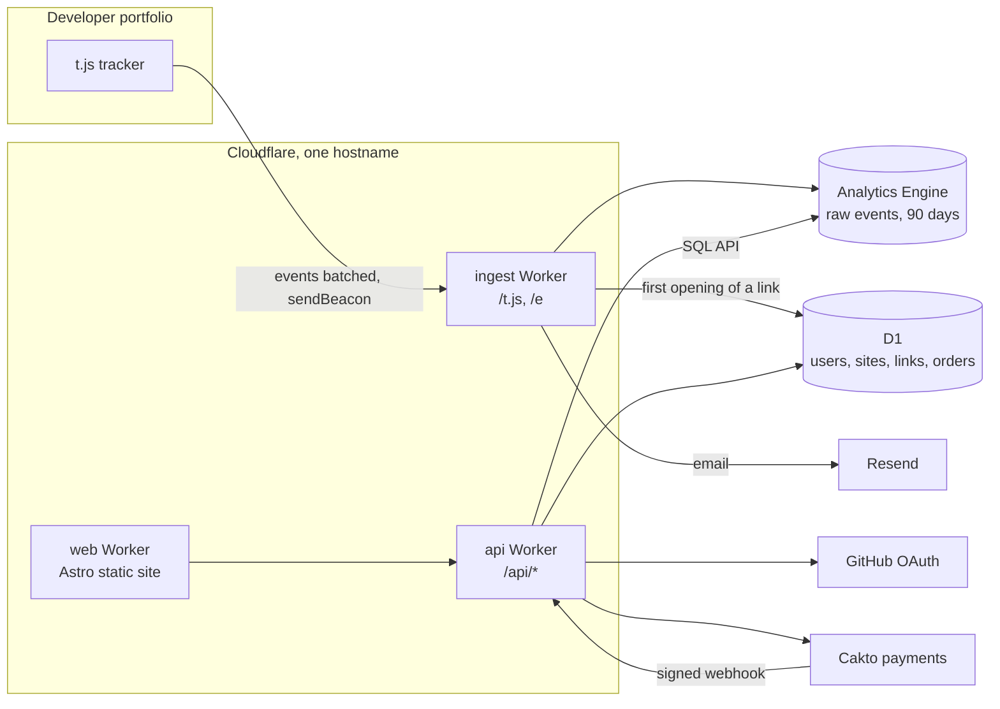

# Devlytics

Free analytics built for developer portfolios. It tells you which projects get attention, what visitors click, and whether the link you sent to a company was opened.

**[devlytics.gabrueldev.com](https://devlytics.gabrueldev.com)**

One tag, no IDs, no cookies:

```html
<script defer src="https://devlytics.gabrueldev.com/t.js"></script>
```


## What you see

**Per-project attention.** The tracker finds project cards on its own and measures how long each one is actually on screen, in a visible tab. It also records clicks to the repository and to the demo.


**Tracked links.** Create one link per job application. You get an email the first time it is opened, and a timeline of every visit: how long they stayed, which projects they looked at and what they clicked.


**Ready-made conversions.** Downloading the résumé and clicks to GitHub, LinkedIn, email and WhatsApp are detected without configuring any event.

**Privacy by default.** Nothing is stored in the visitor's browser. Do Not Track and Global Privacy Control are respected. The IP is only used to compute a daily hash and is never saved, so no cookie banner is needed.

**Buy me a coffee.** Devlytics is free. The coffee page is a custom Pix and card checkout built on the Cakto payments API, with 3-D Secure.


## Architecture



| Piece               | Role                                                                                     |
| ------------------- | ---------------------------------------------------------------------------------------- |
| `packages/tracker`  | About 2.5 kB gzipped. Detects projects and sections, measures attention, batches events  |
| `apps/ingest`       | Validates the origin against registered domains, drops bots, writes to Analytics Engine  |
| `apps/api`          | Dashboard API, GitHub login, tracked links, coffee checkout and the Cakto webhook        |
| `apps/web`          | Astro site: home, dashboard and checkout, in Portuguese and English                      |
| `packages/core`     | Business rules and ports. It imports nothing from Cloudflare or any vendor               |
| `packages/adapters` | D1, Analytics Engine, GitHub, Resend, Cakto and Cache API implementations of those ports |

The code follows ports and adapters: use cases in `core` only know interfaces, and each Worker wires the real adapters in a small container. The reasons behind each choice are written down in [`docs/decisions`](docs/decisions):

1. [Run everything on Cloudflare](docs/decisions/0001-cloudflare-only.md)
2. [Ports and adapters](docs/decisions/0002-ports-and-adapters.md)
3. [No comments in code](docs/decisions/0003-no-comments.md)
4. [One public hostname](docs/decisions/0004-one-hostname.md)
5. [Anonymous daily sessions](docs/decisions/0005-anonymous-sessions.md)
6. [Zero-config detection](docs/decisions/0006-zero-config-detection.md)
7. [Own coffee checkout](docs/decisions/0007-own-coffee-checkout.md)
8. [Tracked links](docs/decisions/0008-tracked-links.md)

### Scaling further

- **Longer history.** Raw events live 90 days in Analytics Engine. A daily cron that rolls them up into D1 would keep history forever at a tiny size.
- **Live visitors.** One Durable Object per site can hold the current visitors and push updates over WebSockets.
- **Heavier ingestion.** Analytics Engine already samples at very high volume. Anything that must be exact, like the first opening of a link or a payment, is written to D1 instead.
- **Abuse.** The ingest endpoint checks the `Origin` against registered domains; a per-site rate limit would be the next step.

## Development

Requires Node 24+ and pnpm.

```sh
pnpm install
pnpm test
pnpm dev
```

| Command                                 | What it does                                                |
| --------------------------------------- | ----------------------------------------------------------- |
| `pnpm typecheck`                        | Strict TypeScript across the workspace                      |
| `pnpm lint`                             | ESLint, including the no-comments rule                      |
| `pnpm test`                             | Vitest, running Workers code inside the real runtime        |
| `pnpm build`                            | Bundles each Worker without deploying                       |
| `pnpm --filter @devlytics/web test:e2e` | Playwright on desktop and mobile: checkout and install flow |

The end-to-end tests run against the built site with every external call faked, including the Cakto SDK, so they never touch real payments. They also load the real tracker on a fake portfolio and check that a visit from a tracked link is reported.

CI runs formatting, lint, types, unit tests, build and the Playwright suite on every push.

## Layout

```
apps/ingest        Worker that serves the tracker and receives events
apps/api           Worker for the dashboard API, checkout and webhooks
apps/web           Astro site: home, dashboard and checkout
packages/core      Business rules and ports, free of any vendor code
packages/adapters  Port implementations for Cloudflare and third parties
packages/tracker   The script that runs on portfolios
packages/shared    Types and validation shared by the tracker, Workers and site
packages/db        D1 schema and migrations
docs/decisions     Why things are the way they are
```
