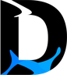
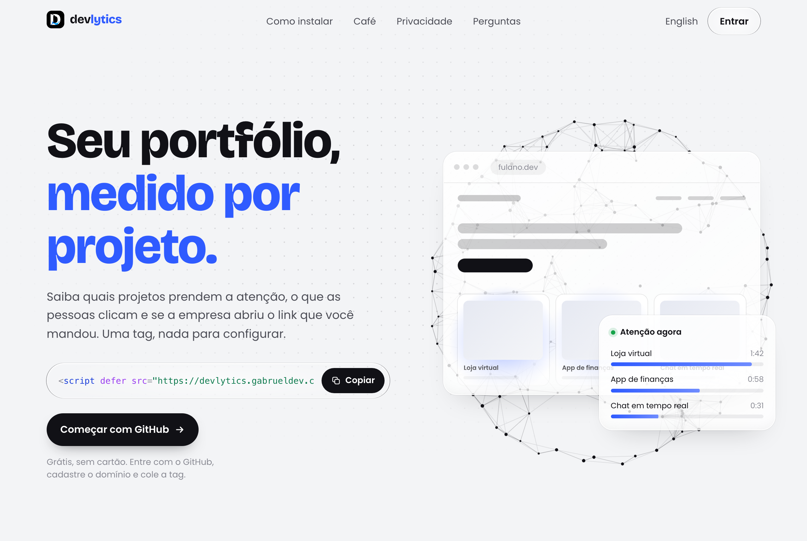
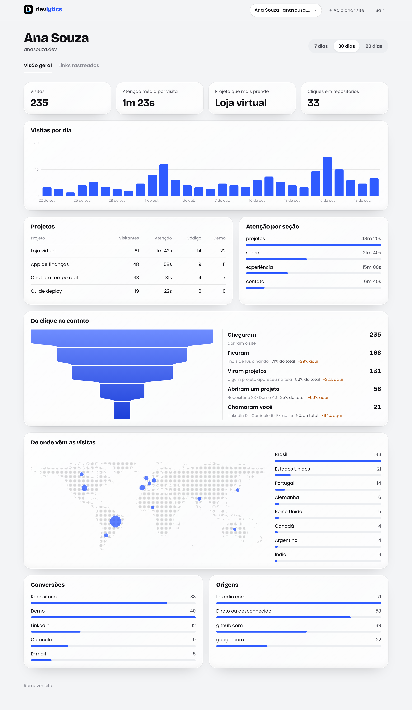
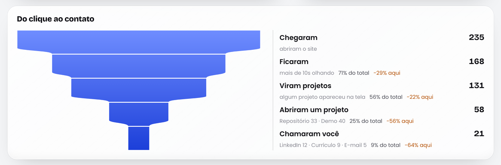
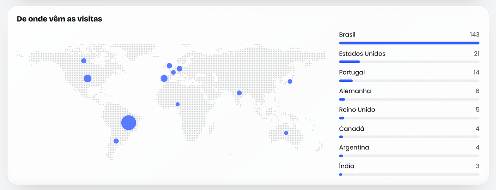
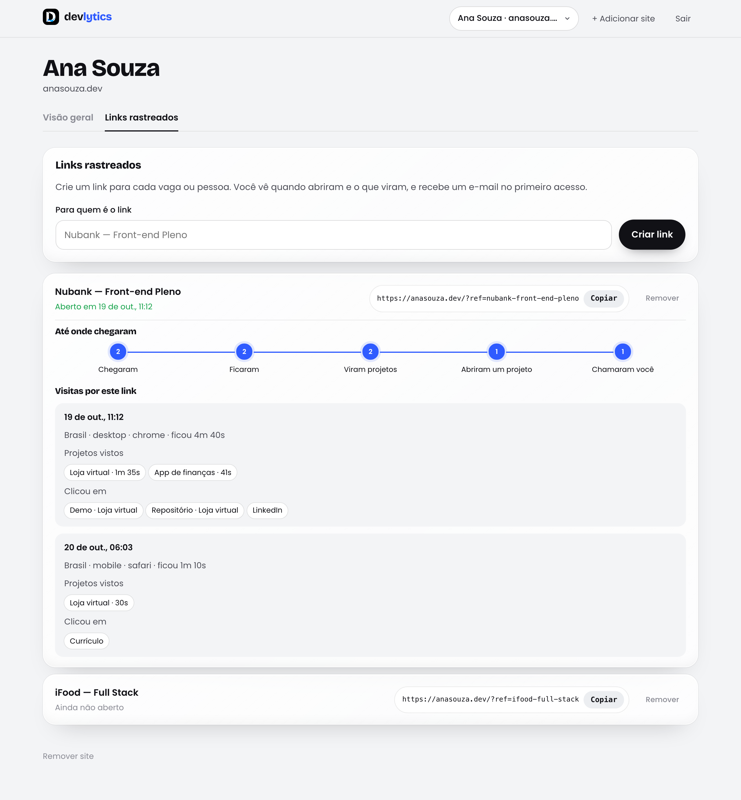
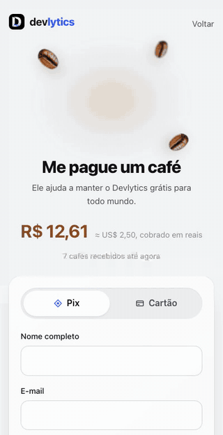
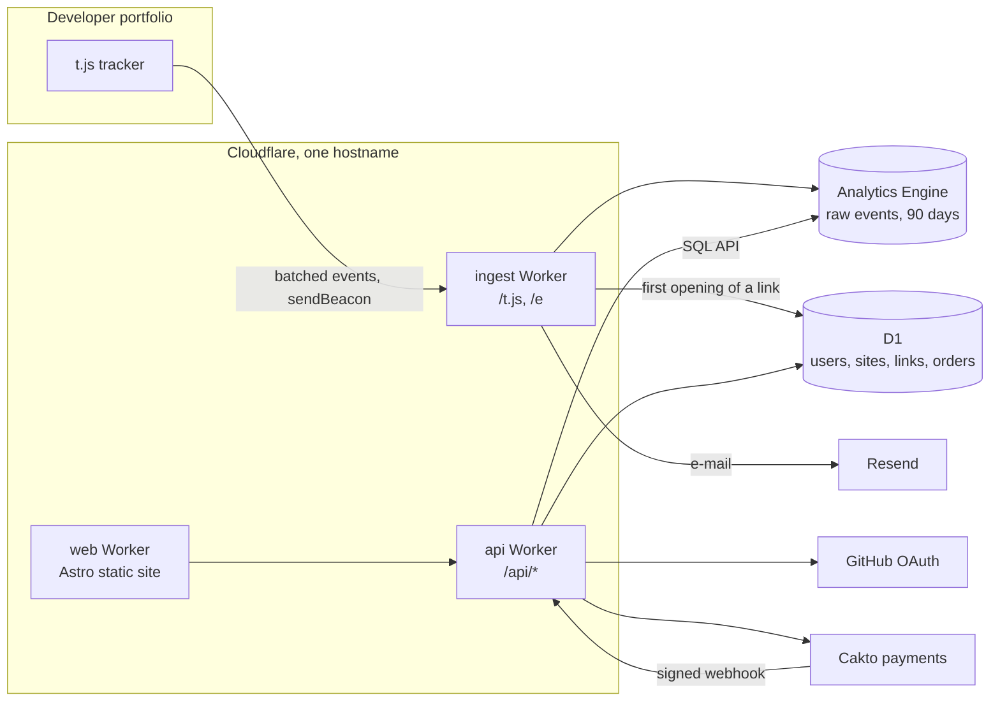
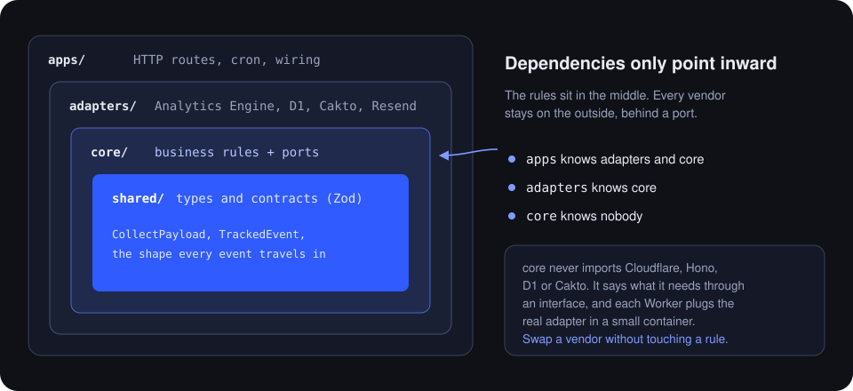

<div align="center">



# Devlytics

**Analytics built for developer portfolios.**<br>
See which projects hold attention, how far visitors get, and whether the company opened the link you sent.

[](https://github.com/gabrueldev/devlytics/actions/workflows/ci.yml)
[](LICENSE)


[**Live site**](https://devlytics.gabrueldev.com) · [Dashboard](https://devlytics.gabrueldev.com/en/dashboard) · [Architecture](#architecture) · [Self-hosting](#self-hosting) · [Decisions](docs/decisions)



</div>

## Why

General analytics count **pages**. A portfolio is one page with six projects on it, and what a developer needs to know is which of those projects people actually look at, whether anyone clicked the demo, and if the recruiter opened the link at all.

Devlytics answers that with one tag, no IDs and no events to configure:

```html
<script defer src="https://devlytics.gabrueldev.com/t.js"></script>
```

It is free, and it stays free: the only revenue is a "buy me a coffee" button.

## Features

### Attention per project, found on its own

The tracker finds project cards and page sections without any markup and measures how long each one is **really on screen**, in a visible tab. Clicks to the repository and to the demo are tied to the project they came from.



### From click to contact

A portfolio has no checkout, so the funnel follows the visitor's journey instead: **arrived → stayed 10 s → saw projects → opened a project → reached out**. Each step shows how many visits got there and where the rest were lost. Reaching out means a click on e-mail, WhatsApp, LinkedIn or the résumé.



### Where visits come from

A dot-matrix world map with one bubble per country, sized by visits. Only the country is stored, never the city or the IP.



### Tracked links

Create one link per job application. You get an **e-mail the first time it is opened**, a trail showing how far that company went, and a timeline of every visit: how long they stayed, which projects they looked at and what they clicked.



### Private by default

- No cookies and nothing stored in the visitor's browser, so no consent banner is needed.
- The IP is only used to compute a session hash that changes every day; it is never saved.
- Do Not Track and Global Privacy Control are respected.
- Bots are dropped before anything is written.

### A real checkout for the coffee



The coffee page is a custom Pix and card checkout on top of the Cakto payments API, with 3-D Secure, a signed webhook and a live counter on the home page. The card number goes straight from the browser to Cakto and never touches this server.

<br clear="right">

## Using it on your portfolio

1. Sign in with GitHub at [devlytics.gabrueldev.com](https://devlytics.gabrueldev.com/en/dashboard).
2. Register your domain.
3. Paste the tag in your `<head>`.

That is all. Detection works on most portfolios as they are. If yours is unusual, three optional attributes let you name things yourself:

| Attribute             | Where            | What it does                                                      |
| --------------------- | ---------------- | ----------------------------------------------------------------- |
| `data-project="Name"` | A project card   | Treats the element as a project and uses that name                |
| `data-section="Name"` | Any block        | Measures it as a section (any `<section id>` is measured already) |
| `data-track="cv"`     | A link or button | Counts clicks under that action, such as `cv`, `email` or `demo`  |

## Architecture

Three Cloudflare Workers behind one hostname, with Analytics Engine for raw events and D1 for everything that must be exact.



### Ports and adapters

The code is layered so that business rules never depend on a vendor.



`core` says what it needs through an interface, the port:

```ts
export interface EventStore {
  append(visit: Visit): Promise<void>;
}
```

A use case receives its dependencies instead of creating them:

```ts
export function recordVisit(deps: {
  sites: SiteRepository;
  events: EventStore;
  sessionSeed: string;
  now: () => Date;
}) {
  return async (incoming: IncomingVisit): Promise<VisitOutcome> => {
    /* … */
  };
}
```

And an adapter implements the port with the real service:

```ts
export class AnalyticsEngineEventStore implements EventStore {
  constructor(private readonly dataset: AnalyticsEngineDataset) {}

  async append(visit: Visit): Promise<void> {
    visit.events.forEach((event) => this.dataset.writeDataPoint(toDataPoint(visit, event)));
  }
}
```

Each Worker wires the real adapters in a small container. Tests use in-memory fakes of the same ports, so every rule in `core` is tested without Cloudflare.

| Package             | Role                                                                                        |
| ------------------- | ------------------------------------------------------------------------------------------- |
| `packages/tracker`  | About 2.5 kB gzipped. Detects projects and sections, measures attention, batches events     |
| `packages/core`     | Business rules and ports. Imports nothing from Cloudflare or any vendor                     |
| `packages/adapters` | D1, Analytics Engine, GitHub, Resend, Cakto and Cache API implementations of those ports    |
| `packages/shared`   | Zod schemas and types shared by the tracker, the Workers and the site                       |
| `packages/db`       | D1 schema and migrations                                                                    |
| `apps/ingest`       | Serves the tracker, checks the origin against registered domains, drops bots, writes events |
| `apps/api`          | Dashboard API, GitHub sign-in, tracked links, coffee checkout and the Cakto webhook         |
| `apps/web`          | Astro site: home, dashboard and checkout, in Portuguese and English                         |

### Decisions

Every non-obvious choice is written down in [`docs/decisions`](docs/decisions), with its context and its cost:

1. [Run everything on Cloudflare](docs/decisions/0001-cloudflare-only.md)
2. [Ports and adapters](docs/decisions/0002-ports-and-adapters.md)
3. [No comments in code](docs/decisions/0003-no-comments.md)
4. [One public hostname](docs/decisions/0004-one-hostname.md)
5. [Anonymous daily sessions](docs/decisions/0005-anonymous-sessions.md)
6. [Zero-config detection](docs/decisions/0006-zero-config-detection.md)
7. [Own coffee checkout](docs/decisions/0007-own-coffee-checkout.md)
8. [Tracked links](docs/decisions/0008-tracked-links.md)
9. [Visit funnel](docs/decisions/0009-visit-funnel.md)

## Development

Requires Node 24+ and pnpm.

```sh
pnpm install
pnpm test
pnpm dev
```

| Command                                 | What it does                                                 |
| --------------------------------------- | ------------------------------------------------------------ |
| `pnpm typecheck`                        | Strict TypeScript across the workspace                       |
| `pnpm lint`                             | ESLint, including the no-comments rule                       |
| `pnpm test`                             | Vitest, running Workers code inside the real runtime         |
| `pnpm build`                            | Bundles each Worker without deploying                        |
| `pnpm --filter @devlytics/web test:e2e` | Playwright on desktop and mobile: checkout and install flows |

The end-to-end tests run against the built site with every external call faked, including the Cakto SDK, so they never touch real payments. They also load the real tracker on a fake portfolio and check that a visit from a tracked link is reported.

CI runs formatting, lint, types, unit tests, build and the Playwright suite on every push.

## Self-hosting

Devlytics runs on a Cloudflare account. You need a domain on Cloudflare and a GitHub OAuth App; Resend (link e-mails) and Cakto (coffee checkout) are optional.

1. Create the D1 database and apply the migrations:

   ```sh
   npx wrangler d1 create devlytics
   npx wrangler d1 migrations apply devlytics --remote --config apps/api/wrangler.jsonc
   ```

2. In each `apps/*/wrangler.jsonc`, set your hostname in `routes`, your `database_id`, and the variables under `vars` (`APP_ORIGIN`, `CF_ACCOUNT_ID`, `GITHUB_CLIENT_ID`, `MAIL_FROM` and so on).

3. Record the secrets. They never live in the repository:

   | Worker   | Secret                 | Used for                                      |
   | -------- | ---------------------- | --------------------------------------------- |
   | `ingest` | `DAILY_SALT_SEED`      | Seed of the daily anonymous session hash      |
   | `ingest` | `RESEND_API_KEY`       | E-mail on the first opening of a tracked link |
   | `api`    | `SESSION_SECRET`       | Signs the dashboard session cookie            |
   | `api`    | `GITHUB_CLIENT_SECRET` | GitHub sign-in                                |
   | `api`    | `CF_ANALYTICS_TOKEN`   | Reads Analytics Engine through its SQL API    |
   | `api`    | `CAKTO_CLIENT_SECRET`  | Creates coffee charges                        |
   | `api`    | `CAKTO_WEBHOOK_SECRET` | Verifies the payment webhook                  |

   ```sh
   cd apps/api && npx wrangler secret put SESSION_SECRET
   ```

4. Build and deploy each Worker:

   ```sh
   pnpm build
   cd apps/ingest && npx wrangler deploy
   cd ../api && npx wrangler deploy
   cd ../web && npx wrangler deploy
   ```

## Roadmap

- **Live visitors.** One Durable Object per site holding the current visitors, pushed over WebSockets.
- **History beyond 90 days.** A daily cron that rolls raw events up into D1.
- **Rate limiting on ingestion.** The origin is already checked against registered domains; a per-site limit is the next layer.

## Contributing

Issues and pull requests are welcome. Before opening one, run:

```sh
pnpm format && pnpm lint && pnpm typecheck && pnpm test
```

The codebase has no comments by design ([why](docs/decisions/0003-no-comments.md)): names carry the meaning, and the reasons behind a choice go in a new file under `docs/decisions`.

## License

[MIT](LICENSE) © Gabriel Rodrigues
